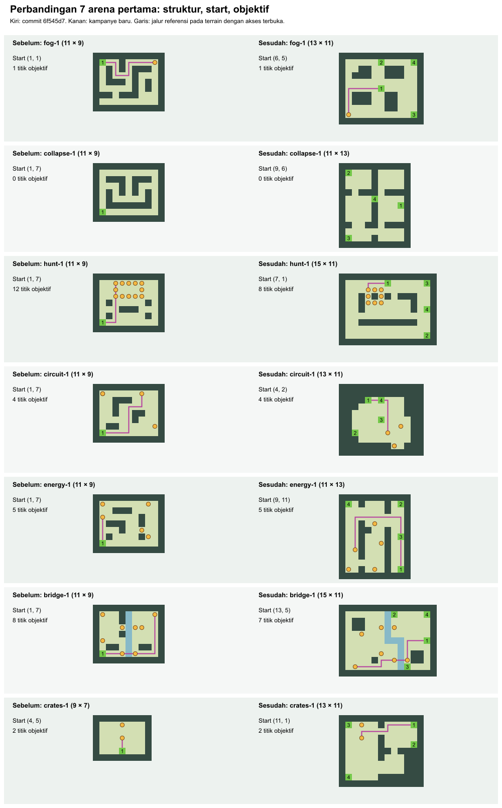
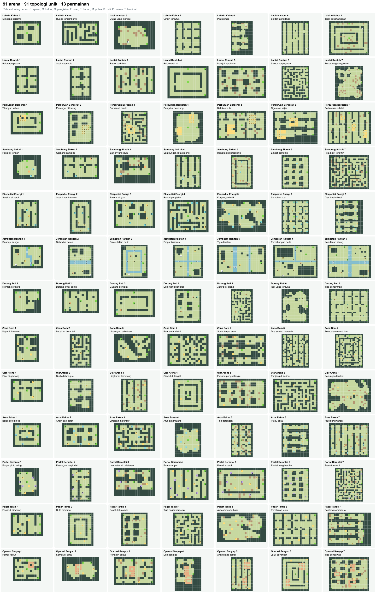

# Audit rombakan map

Dibandingkan dengan commit 6f545d7, seluruh **49/49 topologi**, **49/49 koordinat spawn utama**, serta **49/49 susunan objektif atau gelombang** berubah. Kampanye kini berisi 91 arena pada 13 kategori, masing-masing tujuh level. Semua kategori bisa dimulai secara independen.



Garis pada gambar adalah jalur referensi pada terrain dengan gerbang dan jembatan terbuka. Itu bukan solusi mekanik peti, rencana di bawah kabut, atau hasil pertandingan. Titik mencakup objektif dan prasyarat seperti saklar/stasiun.

## Mengatasi kemiripan

Pemeriksaan lama hanya memastikan bentuk tidak identik setelah rotasi/refleksi. Banyak start tetap di pojok yang sama, papan mengikuti ukuran yang serupa, koridor didominasi satu petak, dan lintasan perburuan berupa persegi. Keunikan exact tersebut tidak cukup untuk membuktikan variasi bermain.

Konten baru memakai pelataran, lorong berjalin, gua, distrik, gugus ruang, sekat dan cincin. Bentuk air Jembatan disusun terpisah: sungai berbelok, selat, parit pulau, kuadran, tiga daratan, delta dan kepulauan silang. Lintasan target/patroli juga berubah bentuk per level. Spawn tersebar di beberapa bagian papan; posisi objektif, dimensi dan rasio papan bervariasi.

Validator sekarang menolak pasangan dalam kategori yang mencapai kemiripan 90% setelah resize dan delapan rotasi/refleksi. Nilai tertinggi pada kampanye ini adalah **87.15%** pada raster 24 × 24. Ini ukuran kemiripan okupansi, bukan persentase kesamaan gameplay atau bukti bahwa semua arena sudah menyenangkan. Jumlah cabang, jalan buntu, putaran dan koordinat ikut dilaporkan.

[Data audit setiap arena](map-audit.json).

## Seluruh 91 arena



Angka hijau adalah tempat awal. Pratinjau ini menampilkan terrain authoring lengkap; permainan Kabut tetap menyembunyikan informasi per peserta. Konten dihasilkan saat build dari konfigurasi dan seed tetap, kemudian disimpan sebagai JSON. Tidak ada pergantian map acak ketika Play.

## Reproduksi

```sh
npm run content:generate
npm run validate:levels
npx tsx scripts/audit-arenas.ts
npx tsx scripts/review-maps.ts
npx tsx scripts/review-map-changes.ts
```
